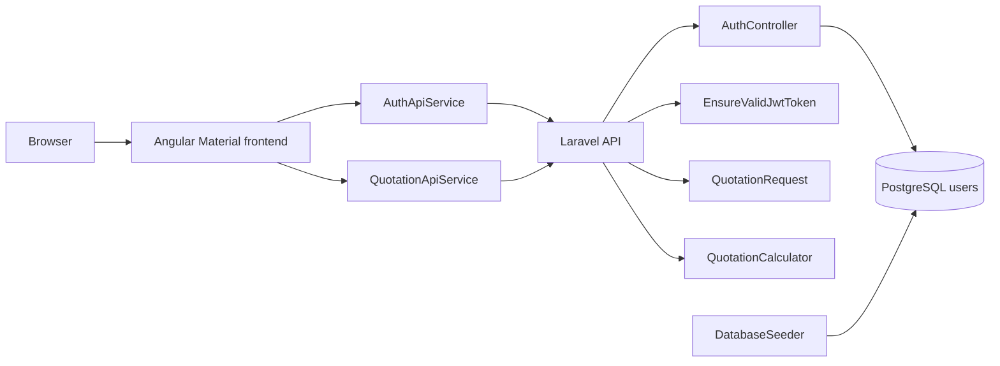
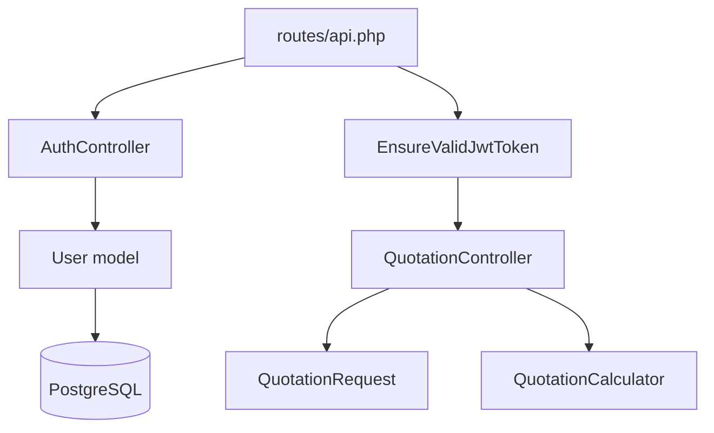
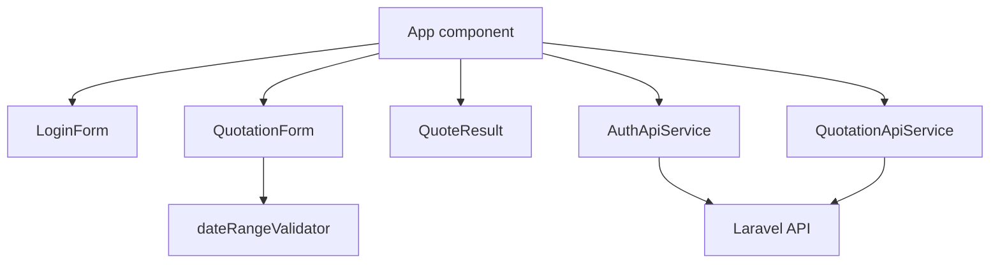
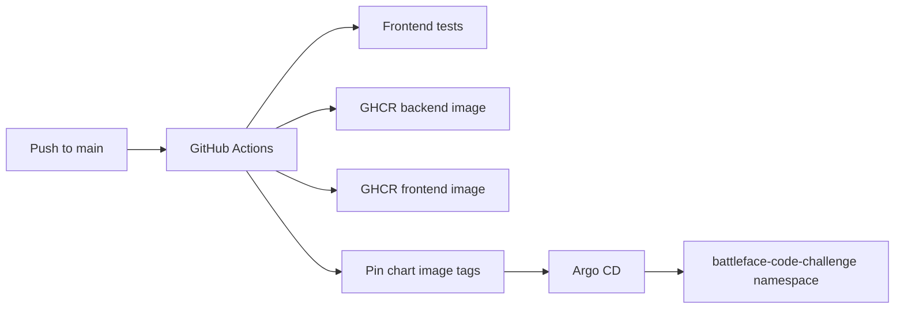

# Architecture

[Back to README](../README.md) | [Decisions](decisions.md) | [Backend](backend.md) | [Frontend](frontend.md) | [Testing](testing.md) | [Docker](docker.md)

The application is split into a Laravel API, an Angular client, local infrastructure, and deployment assets.

## System View

## Backend Structure

- `backend/routes/api.php`: public auth routes and protected quotation route.
- `backend/app/Http/Controllers/AuthController.php`: demo-user login, logout, JWT creation, and cookie writing.
- `backend/app/Http/Middleware/EnsureValidJwtToken.php`: cookie or bearer-token JWT validation.
- `backend/app/Http/Controllers/QuotationController.php`: request validation, calculator orchestration, and response shaping.
- `backend/app/Http/Requests/QuotationRequest.php`: quotation validation rules and comma-separated age parsing.
- `backend/app/Services/QuotationCalculator.php`: fixed-rate, age-load, inclusive trip-length, and currency conversion logic.
- `backend/database/seeders/DatabaseSeeder.php`: creates or updates the configured demo user.

## Frontend Structure

- `frontend/src/app/app.ts`: application shell, auth state, request orchestration, and snackbar feedback.
- `frontend/src/app/features/auth`: login API service and login form component.
- `frontend/src/app/features/quotation`: quotation API service, quote form, quote result, and form validators.
- `frontend/src/app/shared/components/error-banner`: reusable error presentation.
- `frontend/src/app/core/config/api.config.ts`: API base URL injection token.

The app uses Angular standalone components. `App` owns the small page workflow; form components emit typed payloads and services own HTTP calls.

## Runtime Flow

1. The user signs in through the Angular login form.
2. `AuthApiService` posts credentials to `POST /auth/login` with credentials enabled.
3. The Laravel API checks the seeded PostgreSQL user, signs an HS256 JWT, and returns it as an HTTP-only `battleface_token` cookie.
4. The user submits traveller ages, currency, and dates through the quotation form.
5. `QuotationApiService` posts to `POST /quotation`; the browser sends the cookie.
6. `EnsureValidJwtToken` validates the token, then `QuotationRequest` validates and parses the request.
7. `QuotationCalculator` computes `fixedRate * ageLoad * inclusiveTripLength` for each traveller, applies the currency rate, and returns a two-decimal total.

## Deployment Assets

- `deploy/docker/backend/Dockerfile`: PHP CLI/Laravel API image with Composer dependencies and PostgreSQL extension.
- `deploy/docker/frontend/Dockerfile`: Angular build image and nginx static runtime.
- `docker-compose.yml`: local Postgres, API, and Angular dev server.
- `.github/workflows/container.yml`: frontend tests, GHCR image builds, and Helm image tag pinning.
- `deploy/chart`: Helm chart for backend, frontend, Postgres, secrets, and Traefik routing.

