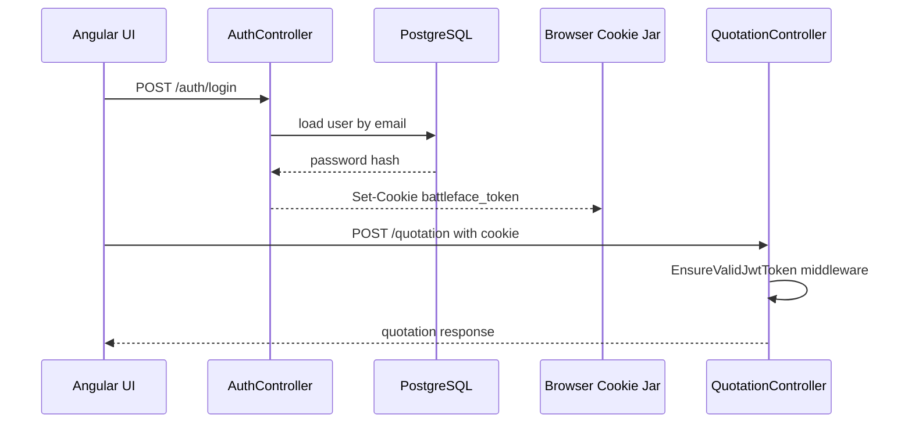

# Backend Development

[Back to README](../README.md) | [Architecture](architecture.md) | [Decisions](decisions.md) | [Frontend](frontend.md) | [Testing](testing.md) | [Docker](docker.md)

Run commands from the project root unless noted.

## Common Commands

Use the Composer container when host PHP is not installed:

```bash
docker run --rm -u $(id -u):$(id -g) -v "$PWD/backend":/app -w /app composer:2 composer install
docker run --rm -u $(id -u):$(id -g) -v "$PWD/backend":/app -w /app composer:2 ./vendor/bin/phpunit
```

If PHP and Composer are installed locally:

```bash
cd backend
composer install
php artisan migrate --seed
./vendor/bin/phpunit
php artisan serve --port=8001
```

The local Docker Compose API is exposed on `http://localhost:8001`. The production container listens on port `8000` internally.

## Environment

Required runtime settings:

- `APP_KEY`: Laravel application key.
- `DB_*`: PostgreSQL connection values.
- `QUOTATION_JWT_SECRET`: HS256 JWT signing secret.
- `QUOTATION_DEMO_EMAIL`: seeded demo user email. Compose defaults to `demo@battleface.test`.
- `QUOTATION_DEMO_PASSWORD`: seeded demo user password.

Optional quotation settings:

- `QUOTATION_JWT_TTL_MINUTES`: token lifetime, default `60`.
- `QUOTATION_COOKIE_NAME`: auth cookie name, default `battleface_token`.
- `QUOTATION_COOKIE_SECURE`: secure-cookie flag, default `true`.
- `QUOTATION_EUR_RATE`, `QUOTATION_GBP_RATE`, `QUOTATION_USD_RATE`: conversion rates used by `QuotationCalculator`.

Do not commit fallback secrets. Docker Compose and Helm require credentials to be supplied explicitly.

## API Endpoints

- `POST /auth/login`
- `POST /auth/logout`
- `POST /quotation`

`POST /quotation` requires either:

- the HTTP-only JWT cookie returned by login, or
- `Authorization: Bearer <jwt>` for direct API testing.

## Quotation Request

```json
{
  "age": "28,35",
  "currency_id": "EUR",
  "start_date": "2026-10-01",
  "end_date": "2026-10-30"
}
```

Validation rules:

- `age`: required comma-separated integer list.
- `currency_id`: one of `EUR`, `GBP`, or `USD`.
- `start_date`: `Y-m-d`.
- `end_date`: `Y-m-d` and on or after `start_date`.
- Each parsed age must be between `18` and `70`.

## Calculation

The calculator uses an inclusive day count and a fixed base rate of `3.0`.

Age loads:

- `18-30`: `0.6`
- `31-40`: `0.7`
- `41-50`: `0.8`
- `51-60`: `0.9`
- `61-70`: `1.0`

Formula:

```text
sum(fixedRate * ageLoad(age) * inclusiveTripLength) * currencyRate
```

The response total is returned as a two-decimal string.

## Authentication Flow



## Database

The database currently stores application users. The `DatabaseSeeder` creates or updates the configured demo account and refuses to run unless both `QUOTATION_DEMO_EMAIL` and `QUOTATION_DEMO_PASSWORD` are configured.

Local Compose runs migrations and seeders through the backend entrypoint:

- `RUN_MIGRATIONS=true`
- `RUN_SEEDERS=true`

For stricter shared environments, run migrations/seeders deliberately rather than relying on startup behavior.
