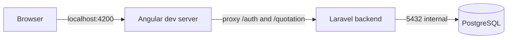

# Docker Deployment

[Back to README](../README.md) | [Architecture](architecture.md) | [Decisions](decisions.md) | [Backend](backend.md) | [Frontend](frontend.md) | [Testing](testing.md)

Docker and Kubernetes assets are split between the root Compose file, `deploy/docker/`, and `deploy/chart/`.

## Local Full Stack

Generate local secrets and start the stack:

```bash
export APP_KEY="$(docker run --rm composer:2 php -r 'echo "base64:".base64_encode(random_bytes(32));')"
export DB_PASSWORD="$(openssl rand -base64 24)"
export QUOTATION_JWT_SECRET="$(openssl rand -base64 32)"
export QUOTATION_DEMO_PASSWORD="choose-a-local-demo-password"
docker compose up
```

Services:

- Frontend: `http://localhost:4200`
- Backend: `http://localhost:8001`
- Postgres: internal service `postgres:5432`



The frontend Compose service runs `npm install` and `npm start -- --host 0.0.0.0 --proxy-config proxy.conf.json`. The proxy targets the Compose backend service at `http://backend:8000`.

## Images

- `deploy/docker/backend/Dockerfile`: installs Composer dependencies, PHP PostgreSQL extension, Laravel source, and the backend entrypoint.
- `deploy/docker/backend/entrypoint.sh`: optionally installs dependencies for bind mounts, runs migrations, runs seeders, then starts the command.
- `deploy/docker/frontend/Dockerfile`: runs the Angular production build and serves `dist/frontend/browser` with nginx.
- `deploy/docker/frontend/nginx.conf`: SPA fallback and `/health` endpoint on port `8080`.

Build directly:

```bash
docker build -f deploy/docker/backend/Dockerfile -t battleface-backend:latest .
docker build -f deploy/docker/frontend/Dockerfile -t battleface-frontend:latest .
```

## GitHub Actions

`.github/workflows/container.yml` runs on `main` pushes and manual dispatch:

1. Install frontend dependencies with npm.
2. Run frontend tests.
3. Build and push backend and frontend images to GHCR.
4. Pin `deploy/chart/values.yaml` image tags to the commit SHA.
5. Commit the values update with `[skip ci]`.

Published images:

- `ghcr.io/and1rew132/battleface-code-challenge-backend`
- `ghcr.io/and1rew132/battleface-code-challenge-frontend`

## Helm Chart

Render the chart:

```bash
helm template battleface deploy/chart \
  --set backend.appKey="$APP_KEY" \
  --set backend.jwtSecret="$QUOTATION_JWT_SECRET" \
  --set backend.demoPassword="$QUOTATION_DEMO_PASSWORD" \
  --set postgres.password="$DB_PASSWORD"
```

Install with ingress enabled:

```bash
helm upgrade --install battleface deploy/chart \
  --set host=battleface.local \
  --set backend.appKey="$APP_KEY" \
  --set backend.jwtSecret="$QUOTATION_JWT_SECRET" \
  --set backend.demoPassword="$QUOTATION_DEMO_PASSWORD" \
  --set postgres.password="$DB_PASSWORD"
```

## Kubernetes Configuration

Primary chart values:

- `host`: public hostname.
- `images.backend.repository` and `images.backend.tag`: backend image.
- `images.frontend.repository` and `images.frontend.tag`: frontend image.
- `backend.appKey`: Laravel `APP_KEY`.
- `backend.jwtSecret`: JWT signing secret.
- `backend.demoEmail` and `backend.demoPassword`: seeded demo user.
- `backend.currencyRates`: configured `EUR`, `GBP`, and `USD` rates.
- `postgres.password`: chart-managed PostgreSQL password.
- `basicAuth`: Traefik Basic Auth middleware settings.

Use existing secrets in shared environments instead of passing sensitive values inline:

- `backend.existingSecret`
- `postgres.existingSecret`
- `imagePullSecrets`
- `basicAuth.secretName`

Cluster commands for CR should be run through:

```bash
ssh cr-k3s "kubectl -n battleface-code-challenge get pods"
```
