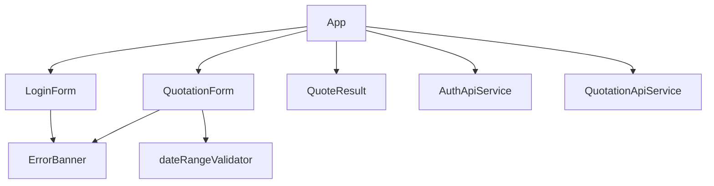

# Frontend Development

[Back to README](../README.md) | [Architecture](architecture.md) | [Decisions](decisions.md) | [Backend](backend.md) | [Testing](testing.md) | [Docker](docker.md)

Run frontend commands from `frontend/`.

## Common Commands

```bash
npm install
npm test
npm run build
npm start
```

The local dev server runs on `http://localhost:4200`. Under Docker Compose it uses `proxy.conf.json` so same-origin calls to `/auth` and `/quotation` reach the Laravel service.

## Source Layout

- `src/app/app.ts`: workflow state, login/logout handling, quote submission, and snackbar errors.
- `src/app/app.html`: authenticated and unauthenticated page shells.
- `src/app/core/config/api.config.ts`: injectable API base URL.
- `src/app/features/auth/auth-api.service.ts`: login/logout HTTP calls.
- `src/app/features/auth/components/login-form`: login form UI.
- `src/app/features/quotation/quotation-api.service.ts`: quotation HTTP calls and API error extraction.
- `src/app/features/quotation/components/quotation-form`: quotation form UI and payload emission.
- `src/app/features/quotation/components/quote-result`: quotation response display.
- `src/app/features/quotation/quotation-form.validators.ts`: client-side date range validator.
- `src/app/shared/components/error-banner`: reusable error display.



## API Configuration

`apiConfig.apiBaseUrl` is currently an empty string, so the browser calls the same origin. This works with:

- Angular dev-server proxy in Compose.
- Traefik routing in Kubernetes.

Both auth and quotation service calls set `withCredentials: true` so the browser includes the HTTP-only JWT cookie.

## Error Handling

`QuotationApiService.errorMessage` normalizes API and network errors:

- Laravel validation errors are flattened from the `errors` object.
- Generic API messages use the response `message`.
- Network failures return `Unable to reach the quotation API.`
- Other failures return `The quotation could not be calculated.`

Components should pass HTTP failures through that helper instead of reading response bodies directly.

## Dependency Practice

Angular is pinned to v20 because this workspace runs Node 20. Newer Angular CLI releases may require newer Node versions. Keep `package.json` and `package-lock.json` in sync by running installs from `frontend/`.
