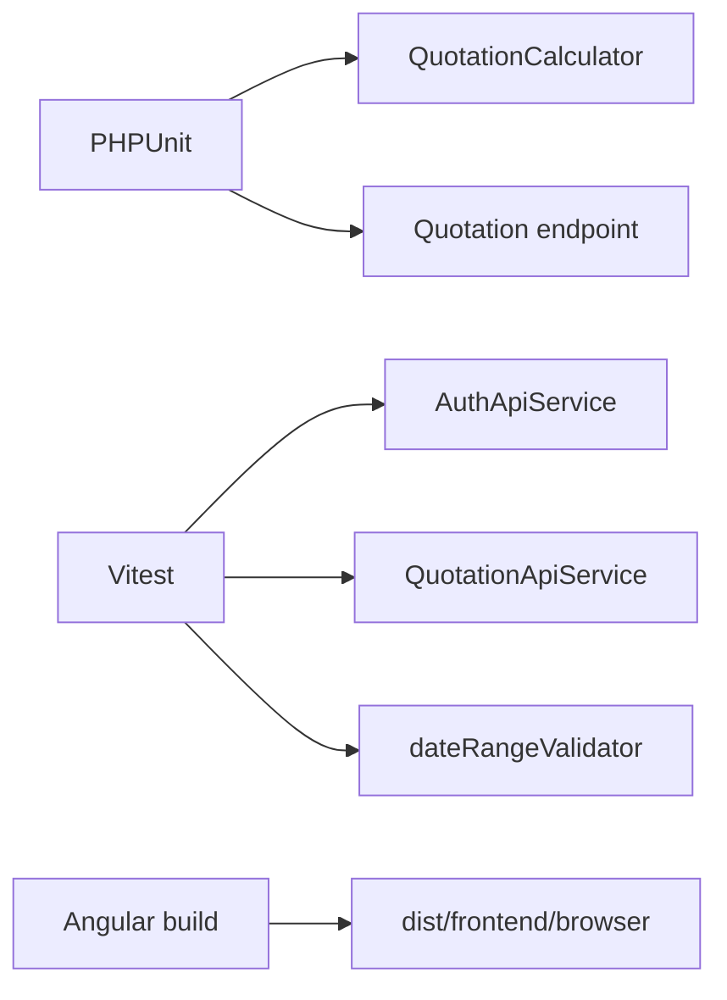

# Testing

[Back to README](../README.md) | [Architecture](architecture.md) | [Decisions](decisions.md) | [Backend](backend.md) | [Frontend](frontend.md) | [Docker](docker.md)

The project has focused backend and frontend tests.

## Backend

Run without host PHP:

```bash
docker run --rm -u $(id -u):$(id -g) -v "$PWD/backend":/app -w /app composer:2 ./vendor/bin/phpunit
```

Run with local PHP/Composer:

```bash
cd backend
composer install
./vendor/bin/phpunit
```

Backend tests:

- `backend/tests/Unit/QuotationCalculatorTest.php`
- `backend/tests/Feature/QuotationEndpointTest.php`

Current coverage focuses on:

- Age-band quotation totals.
- Inclusive trip length.
- Currency conversion.
- Unsupported-age validation.
- Protected quotation endpoint behavior.
- Successful authenticated quotation response.

## Frontend

Run from `frontend/`:

```bash
npm install
npm test
```

Frontend tests:

- `src/app/features/auth/auth-api.service.spec.ts`
- `src/app/features/quotation/quotation-api.service.spec.ts`
- `src/app/features/quotation/quotation-form.validators.spec.ts`

Current coverage focuses on:

- Auth service URLs and credentialed requests.
- Quotation service URLs, credentialed requests, and error message extraction.
- Date range validator behavior.

## Build Verification

```bash
cd frontend
npm run build
```

For a full local smoke test, start Docker Compose, sign in with the seeded demo credentials, submit the README example quote, and confirm the total is `117.00`.


